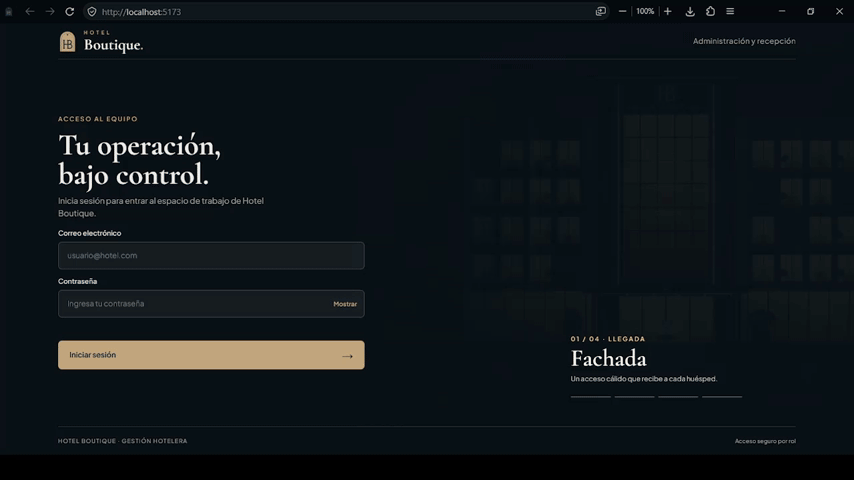
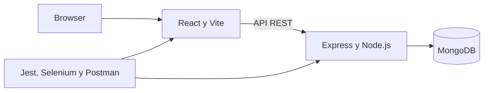

<div align="center">

# Hotel Boutique

### Plataforma web para la administración hotelera y automatización de pruebas

[](https://react.dev/)
[](https://vite.dev/)
[](https://nodejs.org/)
[](https://www.mongodb.com/)
[](https://jestjs.io/)
[](https://www.selenium.dev/)
[](https://www.postman.com/)
[](.github/workflows/ci.yml)



[](https://www.postman.com/imnotseb670-8749507/workspace/testing-pruebas-para-hotel/environment/57446888-06f53965-c57a-4bcf-ad37-e9e03bd9e354?action=share&creator=57446888&active-environment=57446888-06f53965-c57a-4bcf-ad37-e9e03bd9e354)

</div>

## Descripción

Hotel Boutique es una aplicación web para gestionar usuarios, habitaciones, reservaciones, consumos, liquidaciones, pagos y reportes operativos. El proyecto combina un frontend React/Vite con una API REST construida sobre Node.js, Express y MongoDB.

Este repositorio también contiene pruebas unitarias, pruebas de rutas, pruebas de interfaz y una colección Postman ejecutable orientada a validación funcional e integración.

## Arquitectura



- Frontend: React 19, Vite 7 y Testing Library.
- Backend: Express 5, MongoDB/Mongoose y Jest/Supertest.
- Pruebas E2E: Selenium WebDriver con patrón Page Object Model.
- API funcional: colección Postman con 78 solicitudes y 447 validaciones.
- Integración continua: GitHub Actions.

## Tecnologías principales

| Capa | Tecnologías |
|---|---|
| Frontend | React, Vite, JavaScript, CSS |
| Backend | Node.js, Express, Mongoose |
| Base de datos | MongoDB |
| Pruebas unitarias | Jest, Testing Library, Supertest |
| Pruebas de interfaz | Selenium WebDriver |
| Pruebas de API | Postman, Newman, HTMLExtra |
| CI/CD | GitHub Actions |

## Estructura del repositorio

```text
ProyectoDePruebasEImplementacion/
├── backend/
│   ├── postman/
│   │   ├── Hotel-Boutique-API.postman_collection.json
│   │   ├── Hotel-Boutique-Local.postman_environment.example.json
│   │   └── reportes/
│   ├── src/
│   └── package.json
├── frontend/
│   ├── src/
│   ├── tests/
│   │   ├── unit/
│   │   └── e2e/
│   └── package.json
├── performance/
├── repository_Sources/
├── README_PRUEBAS.md
└── README.md
```

## Requisitos previos

- Node.js 20 o superior.
- npm.
- MongoDB o una instancia remota de pruebas aislada.
- Google Chrome para Selenium.
- Postman o Newman para las pruebas de API.

## Inicio rápido

### Backend

```bash
cd backend
npm install
npm run dev
```

La API local escucha normalmente en `http://localhost:3000`.

### Frontend

```bash
cd frontend
npm install
npm run dev
```

La interfaz estará disponible en `http://localhost:5173`.

No se deben ejecutar pruebas destructivas contra bases de datos de producción. Usa una base exclusiva para pruebas y crea datos que puedan identificarse y limpiarse.

## Ejecución de pruebas

### Backend

```bash
cd backend
npm run test:unit
npm test -- --runInBand
```

### Frontend con Jest

```bash
cd frontend
npm run test:unit
```

Las pruebas unitarias frontend usan mocks de API y no modifican datos reales.

### Frontend con Selenium

Primero inicia el backend y el frontend. Luego configura las variables necesarias y ejecuta:

```powershell
cd frontend
$env:TEST_APP_URL = "http://localhost:5173"
$env:TEST_USER_EMAIL = "<correo-de-prueba>"
$env:TEST_USER_PASSWORD = "<contraseña-de-prueba>"
npm run test:e2e
```

La suite Selenium usa el patrón Page Object Model y cierra automáticamente el navegador. Las credenciales y datos de producción no deben utilizarse.

### API con Newman

```bash
npx --yes newman run backend/postman/Hotel-Boutique-API.postman_collection.json \
  --environment backend/postman/Hotel-Boutique-Local.postman_environment.example.json
```

## API de pruebas desplegada

Para ejecutar la colección desde el entorno compartido sin configurar el proyecto localmente:

1. Abre el entorno `testing-pruebas-para-hotel` en tu workspace de Postman.
2. En Environments, actualiza los valores y guarda con `Ctrl+S`.

| Variable | Valor |
|---|---|
| `baseUrl` | `https://hotel-boutique-api-pruebas.onrender.com` |
| `maxResponseMs` | `10000` |
| `adminEmail` | `qa-admin@hotelboutique.test` |
| `adminPassword` | `Hb-QA-mu8E-rXH8` |

Las variables `testReceptionPassword`, `rotatedReceptionPassword` y `managedTestPassword` pueden mantenerse como estén si tienen al menos 8 caracteres y la segunda contraseña es distinta a la primera.

Estas credenciales existen únicamente en la base de pruebas. No introduzcas credenciales de producción, como `administrador@hotelboutique.com`, ni la URL de producción `hotel-boutique-api.onrender.com`. El workspace público permite que cualquier usuario vea sus valores.

Antes de ejecutar la colección:

1. Abre [https://hotel-boutique-api-pruebas.onrender.com/health](https://hotel-boutique-api-pruebas.onrender.com/health).
2. Espera a que responda, incluso hasta aproximadamente un minuto, porque Render puede dejar dormida la API después de 15 minutos sin uso.
3. Ejecuta la colección completa de arriba hacia abajo con una iteración.

La API admite 100 solicitudes cada 15 minutos por persona. La colección completa realiza 78 solicitudes, por lo que conviene esperar el periodo de refresco si se alcanza el límite.

Resultado previamente validado: **78/78 solicitudes y 447/447 pruebas aprobadas**.

## Reportes y evidencias

Los resultados de Postman incluyen ejecución local y desplegada, capturas del resumen y el reporte HTML:

- [Documentación de reportes](backend/postman/reportes/README.md)
- [Reporte HTML](backend/postman/reportes/reporte-postman-render.html)
- [Reporte JSON](backend/postman/reportes/reporte-postman-hotel-boutique.json)
- [Resumen de ejecución](backend/postman/reportes/01-resumen-ejecucion.jpeg)

La ejecución publicada utilizó una base aislada llamada `proyectoSemestre_pruebas`, independiente de producción.

## Integración continua

El workflow [ci.yml](.github/workflows/ci.yml) levanta MongoDB como replica set, crea los datos de prueba necesarios, inicia el backend y ejecuta Jest junto con Newman. Los resultados Newman quedan disponibles como artefactos de la ejecución.

## Documentación relacionada

- [Guía general de pruebas](README_PRUEBAS.md)
- [Documentación del backend](backend/README.md)
- [Documentación del frontend](frontend/README.md)
- [Guía de Postman](backend/postman/README.md)
- [Colección de API](backend/postman/Hotel-Boutique-API.postman_collection.json)
- [Plantilla de entorno local](backend/postman/Hotel-Boutique-Local.postman_environment.example.json)

## Seguridad y datos sensibles

- Los valores secretos deben mantenerse fuera de Git.
- Los entornos locales pueden usar archivos `.env.example` como referencia.
- Las bases de datos y cuentas usadas para pruebas deben estar separadas de producción.
- Los tokens obtenidos durante las pruebas no deben versionarse.
